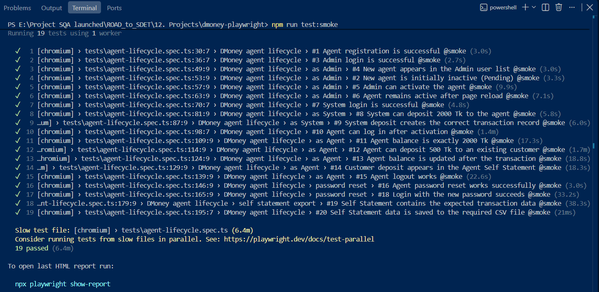

# DMoney Portal: Playwright Automation

End-to-end automation of the DMoney Portal **Agent lifecycle** (Batch 19 assignment), built with
Playwright and TypeScript using the Page Object Model and custom fixtures.

**Journey:** register an Agent → Admin activates → System deposits 2000 Tk → Agent deposits 500 Tk to a
Customer → logout → password reset → login with old/new password → export the Self Statement to
`output/self_statement_YYYY-MM-DD.csv`.

## Results

### Full run video (headed mode)
[Watch the full automation video] https://drive.google.com/file/d/14ySwY4GhqmZety3IWghoSls2_zJSYbZy/view?usp=sharing

### Regression test result (20 tests)


### Smoke test result (19 positive tests)


## Tech stack
Playwright Test, TypeScript, dotenv, imapflow + mailparser (OTP from Gmail).

## Project structure
```
src/
  config/     constants, environment loading
  fixtures/   page-object fixtures
  pages/      Page Objects (all locators live here)
  utils/      csv, date, money, OTP and reset-link readers, test data
tests/        agent-lifecycle.spec.ts (all 20 validations)
output/       generated Self Statement CSV
docs/         screenshots used in this README
```

## Setup
1. Start the DMoney web app (`localhost:3000`) and the API server.
2. Start the API server so that its output is also saved to a file (the password reset link is only
   printed there, because the app's reset email fails to send):
```powershell
   npm run dev | Tee-Object -FilePath <path>\api.log
```
3. Install and configure:
```bash
   npm install
   npx playwright install chromium
   cp .env.example .env
```
4. Fill in `.env`: an existing customer's phone, your Gmail address with a Gmail
   [App Password](https://myaccount.google.com/apppasswords), and the `api.log` path.

## Run
| Command | What it does |
|---|---|
| `npm run test:headed` | Full regression, visible browser |
| `npm run test:regression` | Full regression (20 tests) |
| `npm run test:smoke` | Smoke suite: positive tests only (`@smoke`, 19 tests) |
| `npm run report` | Open the HTML report |

## Test coverage
All tests are in `tests/agent-lifecycle.spec.ts`. `#17` is the only negative case, so it is excluded from smoke.

| # | Validation | Smoke |
|---|---|---|
| 1 | Agent registration is successful | ✔ |
| 2 | New agent is initially inactive (Pending) | ✔ |
| 3 | Admin login is successful | ✔ |
| 4 | New agent appears in the Admin user list | ✔ |
| 5 | Admin can activate the agent | ✔ |
| 6 | Agent remains active after page reload | ✔ |
| 7 | System login is successful | ✔ |
| 8 | System can deposit 2000 Tk to the agent | ✔ |
| 9 | System deposit creates the correct transaction record | ✔ |
| 10 | Agent can log in after activation | ✔ |
| 11 | Agent balance is exactly 2000 Tk | ✔ |
| 12 | Agent can deposit 500 Tk to an existing customer | ✔ |
| 13 | Agent balance is updated correctly after the transaction | ✔ |
| 14 | Customer deposit appears in the Agent's Self Statement | ✔ |
| 15 | Agent logout works | ✔ |
| 16 | Agent password reset works | ✔ |
| 17 | Login with the old password fails after reset | |
| 18 | Login with the new password succeeds | ✔ |
| 19 | Self Statement contains the expected transaction data | ✔ |
| 20 | Self Statement data is saved to the required CSV file | ✔ |

## Design decisions
- **Serial journey:** the flow is one dependent business process, so tests run in order in one worker.
  Each test gets a fresh browser context and signs in by itself, so sessions never leak between tests.
- **Unique data per run:** the agent's email is a Gmail alias (`name+agent<timestamp>@gmail.com`), so
  reruns never collide and the OTP email still reaches one inbox.
- **Agent OTP:** read automatically from Gmail over IMAP, only accepting an email that arrives after login starts.
- **Password reset link:** read from the API server log, because the app's reset email fails to send.
- **Locators only in Page Objects**, role/label based. No hard waits: web-first assertions only.
- **Date in Asia/Dhaka** for the CSV file name, because UTC gives the wrong day between 00:00 and 06:00.
- **Secrets** live in `.env` (gitignored); `.env.example` is committed.

## Observations about the application under test
- Cash-in credits the agent a commission (12.5 Tk for 500 Tk, per the API docs), so the balance after
  depositing 500 Tk is 1512.5, not 1500.
- Forgot password: the API answers `200`, but sending the email fails (`gmail-service-account.json` not found).
- The Self Statement pager can show "1–20 of N" while fewer rows are displayed.